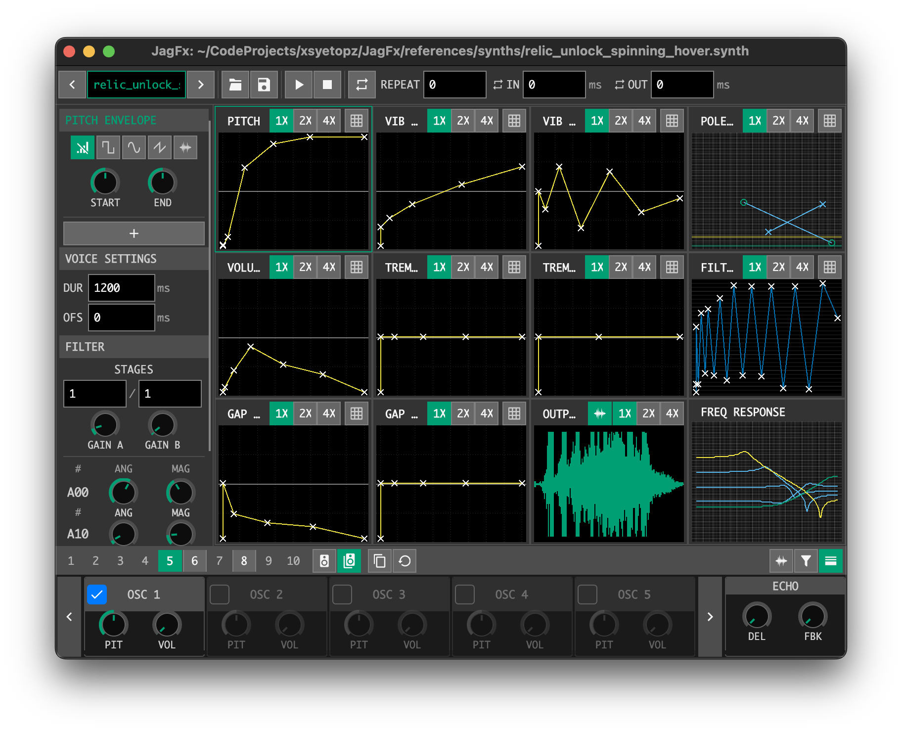
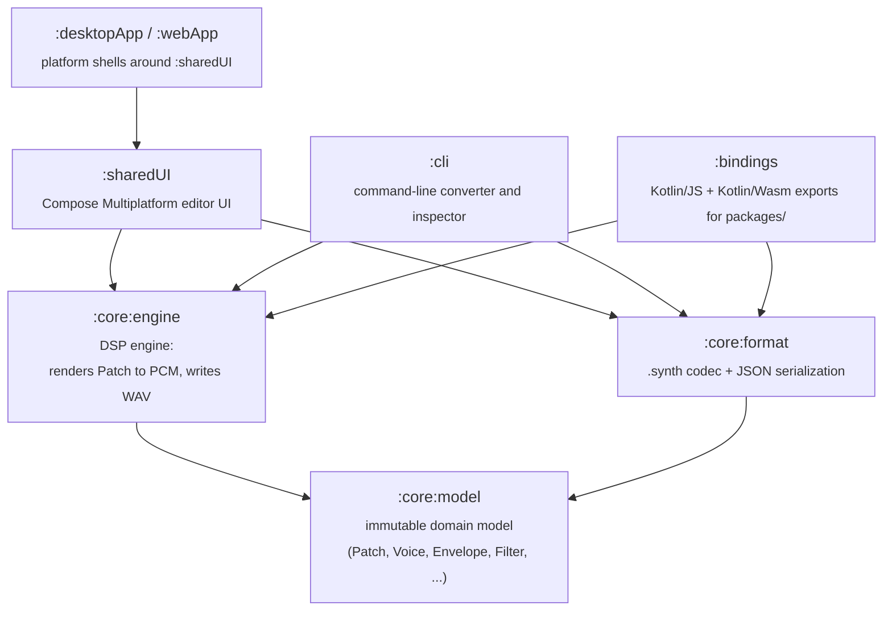
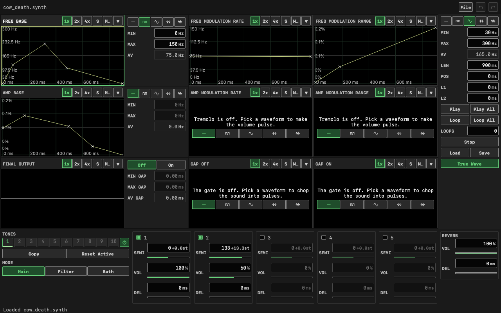
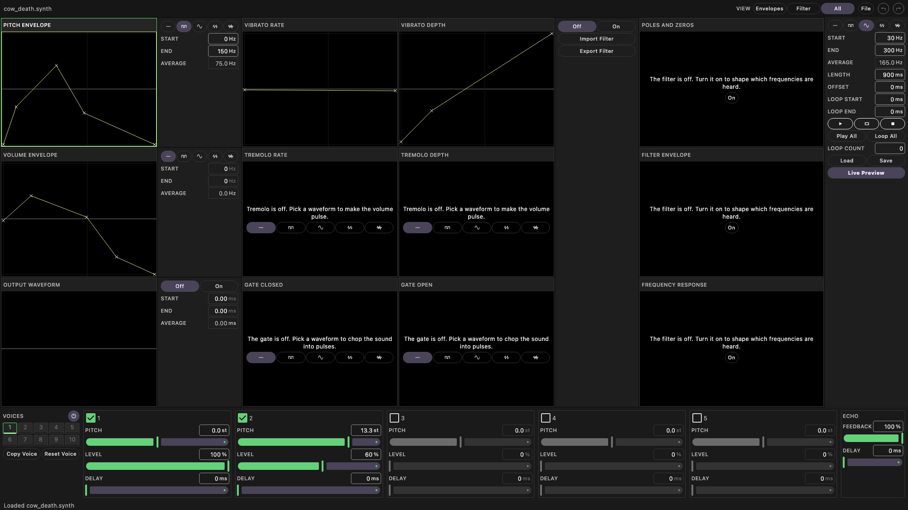

# Jagex Synth Editor

<p align="left">
  
</p>

JagFx edits Jagex Audio Synthesis (`.synth`) files, the sound-effect format used by OldSchool RuneScape. It opens, edits, images, and exports OSRS synth patches.

---

## Features

| Area | What JagFx does |
| --- | --- |
| Signal chain | Edits the 9 envelope slots in each voice: pitch, volume, vibrato rate/depth, tremolo rate/depth, gap off/on, and filter. |
| Envelopes | Edits multi-segment envelopes with waveform, start value, end value, and breakpoint controls. |
| Partials | Edits 10 additive partial slots per voice: amplitude, pitch offset, delay, and active state. |
| Filter | Edits the IIR filter and shows the frequency response. |
| Modulation | Renders vibrato, tremolo, gap envelopes, echo, and filter modulation. |
| Export | Saves `.synth`, exports `.wav`, and converts `.synth` to JSON. |
| JSON | Uses a schema-backed JSON format for patch generation, inspection, and diffs. |

---

## Getting Started

Requires JDK 21 and Bun.

```bash
git clone https://github.com/xsyetopz/JagFx.git && cd JagFx
bun install           # installs the husky + commitlint commit-msg hook
./gradlew check       # tests, spotless, and detekt
```

---

## Project Structure



---

## Desktop GUI

```bash
./gradlew :desktopApp:run
```



The editor follows the layout of the original JagFx tool:

- **Title bar**: the file name, the File menu (Open, New, Save As, Import and Export tone, theme, text size, panel side), Undo, and Redo.
- **Rack**: three rows (Freq, Amp, Output) across Base, Modulation rate, and Modulation range. A strip beside each Base cell holds the module's waveform, Min, Max, and average, or the gate's Off/On and gaps.
- **Cell headers**: `1x 2x 4x` zoom presets, `S` fits the view, `M…` links the cell's time view to the other cells or gives it its own, and `▼` opens the cell's controls panel with the exact point table.
- **Voice strip**: the oscillator, Len, Pos, L1, L2, Play, Play All, Loop, Loop All, Loops, Stop, Load, Save, and True Wave. The File menu moves it to the left or right edge.
- **Bottom bar**: Tones 1 to 10 with Copy and Reset Active, the Mode switch, five harmonic boxes (Semi, Vol, Del), and Reverb.
- **Mode switch**: Main shows the rack, Filter shows the filter column (Graph of poles and zeros, Transition Curve, Frequency Response), and Both shows the two side by side.



### Mouse

- Drag a point to move it. Double-click a line to add a point, and right-click for the point menu.
- Ctrl or Cmd with the wheel zooms around the pointer. A middle-button drag pans.
- Double-click a cell header to open the cell over the whole rack.

### Keyboard

Ctrl means Cmd on macOS.

| Keys | Action |
| --- | --- |
| Tab, Shift+Tab | Move through the title bar, the voice strip, the rack row by row, and the bottom bar |
| Alt+Left, Alt+Right | Select the previous or next cell |
| Alt+Up, Alt+Down | Select the cell one rack row up or down |
| Left, Right | Select the previous or next point of the focused envelope |
| Home, End | Select the first or last point |
| Shift+Arrows | Move the selected point 1024 raw units |
| Ctrl+Arrows | Move the selected point 64 raw units |
| Insert or `+` | Add a point after the selected one |
| Delete or Backspace | Remove the selected point |
| Ctrl+`+`, Ctrl+`-` | Zoom the focused plot in or out |
| Shift+Page Up, Shift+Page Down | Pan a time plot by one screen |
| Space | Play or stop the selected tone (desktop) |
| Escape | Stop playback |
| Ctrl+P, Ctrl+Shift+L | Play All, Loop All (desktop) |
| Ctrl+L, Ctrl+. | Loop, Stop (desktop) |
| Ctrl+1 to Ctrl+0 | Select tone 1 to 10 (desktop) |
| Ctrl+Alt+1, 2, 3 | Mode Main, Filter, Both (desktop) |
| Ctrl+O, Ctrl+S, Ctrl+Shift+S | Open, Save, Save As (desktop) |
| Ctrl+Z, Ctrl+Shift+Z | Undo, Redo (desktop) |

See [`docs/accessibility.md`](docs/accessibility.md) for the accessibility statement.

The same UI runs in the browser (`./gradlew :webApp:wasmJsBrowserDevelopmentRun`).

---

## CLI

```bash
./gradlew :cli:installDist        # installs cli/build/install/jagfx/bin/jagfx
alias jagfx=cli/build/install/jagfx/bin/jagfx

# convert .synth to .wav
jagfx input.synth output.wav
jagfx input.synth output.wav 4     # with loop count
jagfx -i input.synth -o output.wav -l 4

# inspect
jagfx inspect input.synth

# JSON round-trip
jagfx to-json input.synth output.json
jagfx from-json input.json output.synth
```

Without installing: `./gradlew :cli:run --args='inspect input.synth'`.

See `docs/synth-format-spec.md` for the binary format, `schemas/synth.schema.json` for the JSON schema, and `references/json/` for JSON generated from the reference `.synth` files.

---

## Building for Distribution

| Target | Output |
| --- | --- |
| `just release-desktop` | `publish/` installer for the host OS: `.dmg` on macOS, `.msi` on Windows, `.deb` on Linux |
| `just release-cli` | `publish/jagfx-cli-<ver>.zip` (runs anywhere with Java 21+) |
| `just release-all` | Desktop installer + CLI zip |

jpackage builds only for the host OS and architecture. The desktop installers bundle a Temurin JRE, so users do not need Java. The release version comes from `gradle.properties` (currently 3.0.0). The release workflow builds every platform and signs and notarizes macOS DMGs when the required GitHub secrets are configured.

For host-specific release steps on macOS, Windows, or Linux, see [PUBLISHING.md](PUBLISHING.md).

---

## Contributing

See [CONTRIBUTING.md](CONTRIBUTING.md) for the workflow, coding guidelines, and pull request checklist.

---

## Star History

<a href="https://www.star-history.com/?repos=xsyetopz%2FJagFx&type=date&legend=top-left">
 <picture>
   <source media="(prefers-color-scheme: dark)" srcset="https://api.star-history.com/chart?repos=xsyetopz/JagFx&type=date&theme=dark&legend=top-left" />
   <source media="(prefers-color-scheme: light)" srcset="https://api.star-history.com/chart?repos=xsyetopz/JagFx&type=date&legend=top-left" />
   
 </picture>
</a>

---

## License

[MIT](LICENSE)

---

## Acknowledgments

- [Lost City](https://github.com/LostCityRS): client-version references for `.synth` files

- [OpenOSRS](https://github.com/open-osrs/runelite/tree/master/runescape-client): decompiled client references for the `.synth` format and IIR filter
