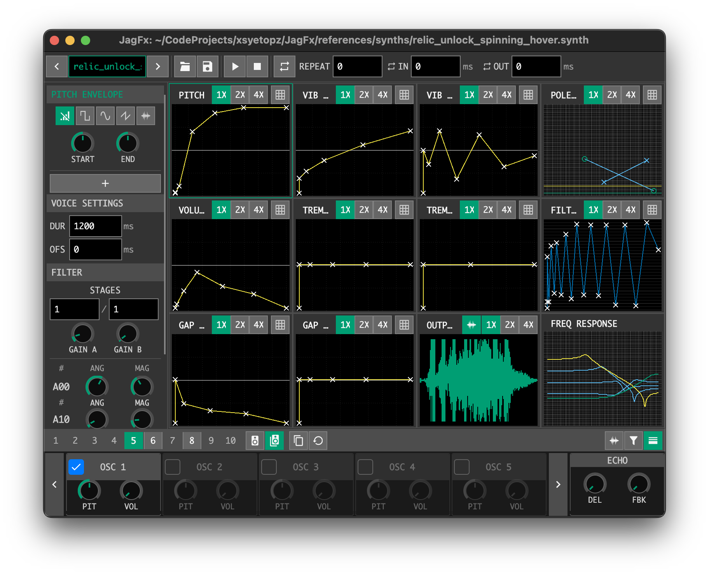
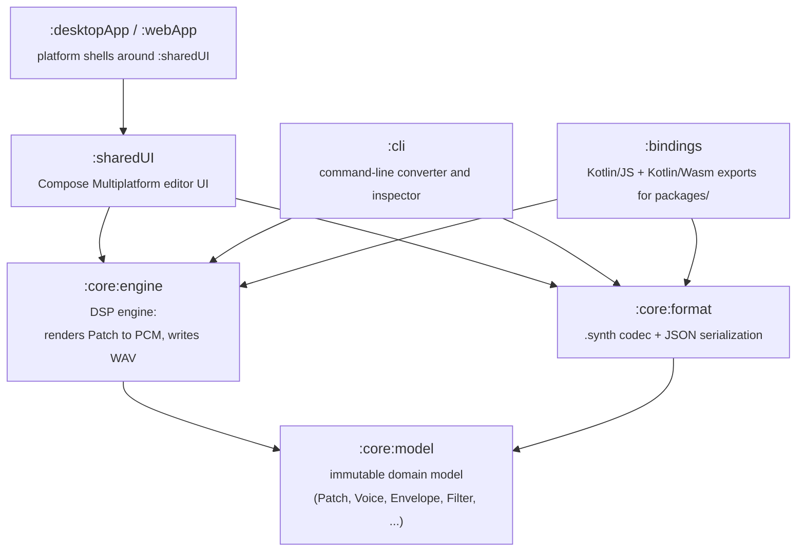

# Jagex Synth Editor

<p align="left">
  
</p>

JagFx edits Jagex Audio Synthesis (`.synth`) files, the sound-effect format used by OldSchool RuneScape. It opens, edits, images, and exports OSRS synth patches.

---

## Features

| Area | What JagFx does |
| --- | --- |
| Signal chain | Edits the 9 envelope slots in each voice: pitch, volume, vibrato rate/depth, tremolo rate/depth, gap off/on, and filter. |
| Envelopes | Edits multi-segment envelopes with waveform, start value, end value, and breakpoint controls. |
| Partials | Edits 10 additive partial slots per voice: amplitude, pitch offset, delay, and active state. |
| Filter | Edits the IIR filter and shows the frequency response. |
| Modulation | Renders vibrato, tremolo, gap envelopes, echo, and filter modulation. |
| Export | Saves `.synth`, exports `.wav`, and converts `.synth` to JSON. |
| JSON | Uses a schema-backed JSON format for patch generation, inspection, and diffs. |

---

## Getting Started

Requires JDK 21 and Bun.

```bash
git clone https://github.com/xsyetopz/JagFx.git && cd JagFx
bun install           # installs the husky + commitlint commit-msg hook
./gradlew check       # tests, spotless, and detekt
```

---

## Project Structure



---

## Desktop GUI

```bash
./gradlew :desktopApp:run
```

```text
┌-----------------------------------------------------┐
│  Toolbar: file, transport, loop, undo/redo          │
├--------------┬--------------------------------------┤
│              │                                      │
│  Inspector   │        Canvas Grid                   │
│  Panel       │     (envelope and filter canvases)   │
│              │                                      │
├--------------┴--------------------------------------┤
│  Voice Bar: voice slots, copy/reset, grid mode      │
│  Partial Bar: 10 additive partials + echo           │
│  Status Bar                                         │
└-----------------------------------------------------┘
```

- Toolbar: open, save, save as, play/stop, loop controls (count, start, end), and undo/redo.
- Canvas grid: envelope, filter, and output canvases for the selected voice; the grid mode toggles choose main, filter, or both.
- Inspector panel: controls for the selected envelope: START/END knobs, segment list, filter editor, and echo knobs.
- Voice bar: voice slot buttons, enable, copy, and reset, plus the grid mode toggles.
- Partial bar: `10` additive partials with volume, decicent offset, and delay, plus the echo cell.
- Envelope canvas: double-click to insert breakpoints, right-click for context menu, Delete or Backspace to remove points. Scroll-wheel zoom, drag to pan when zoomed.
- Narrow windows (phones, small browser windows) show all panels in one scrolling column.

The same UI runs in the browser (`./gradlew :webApp:wasmJsBrowserDevelopmentRun`).

---

## CLI

```bash
./gradlew :cli:installDist        # installs cli/build/install/jagfx/bin/jagfx
alias jagfx=cli/build/install/jagfx/bin/jagfx

# convert .synth to .wav
jagfx input.synth output.wav
jagfx input.synth output.wav 4     # with loop count
jagfx -i input.synth -o output.wav -l 4

# inspect
jagfx inspect input.synth

# JSON round-trip
jagfx to-json input.synth output.json
jagfx from-json input.json output.synth
```

Without installing: `./gradlew :cli:run --args='inspect input.synth'`.

See `docs/synth-format-spec.md` for the binary format, `schemas/synth.schema.json` for the JSON schema, and `references/json/` for JSON generated from the reference `.synth` files.

---

## Building for Distribution

| Target | Output |
| --- | --- |
| `just release-desktop` | `publish/` installer for the host OS: `.dmg` on macOS, `.msi` on Windows, `.deb` on Linux |
| `just release-cli` | `publish/jagfx-cli-<ver>.zip` (runs anywhere with Java 21+) |
| `just release-all` | Desktop installer + CLI zip |

jpackage builds only for the host OS and architecture. The desktop installers bundle a Temurin JRE, so users do not need Java. The release version comes from `gradle.properties` (currently 3.0.0). The release workflow builds every platform and signs and notarizes macOS DMGs when the required GitHub secrets are configured.

For host-specific release steps on macOS, Windows, or Linux, see [PUBLISHING.md](PUBLISHING.md).

---

## Contributing

See [CONTRIBUTING.md](CONTRIBUTING.md) for the workflow, coding guidelines, and pull request checklist.

---

## Star History

<a href="https://www.star-history.com/?repos=xsyetopz%2FJagFx&type=date&legend=top-left">
 <picture>
   <source media="(prefers-color-scheme: dark)" srcset="https://api.star-history.com/chart?repos=xsyetopz/JagFx&type=date&theme=dark&legend=top-left" />
   <source media="(prefers-color-scheme: light)" srcset="https://api.star-history.com/chart?repos=xsyetopz/JagFx&type=date&legend=top-left" />
   
 </picture>
</a>

---

## License

[MIT](LICENSE)

---

## Acknowledgments

- [Lost City](https://github.com/LostCityRS): client-version references for `.synth` files

- [OpenOSRS](https://github.com/open-osrs/runelite/tree/master/runescape-client): decompiled client references for the `.synth` format and IIR filter
